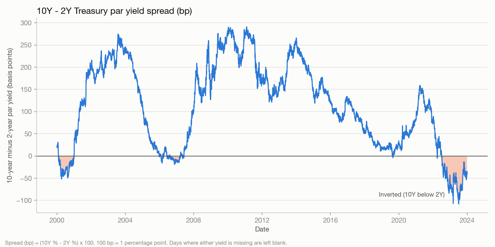

# US Treasury Yield Curve Project

A small learning project that loads, checks and visualizes US Treasury **par yield curve** data (2000-2023) with pandas and matplotlib, and runs one descriptive research question about the 10-year minus 2-year yield spread.

This is a research and learning project. It is **not** a trading strategy and makes no claims about profits.

## Current progress

Implemented:

1. **Data loading and checks** - combines three CSV files with different layouts into one table, parses dates, sorts, checks for duplicate dates and reports missing values (never fills them).
2. **Charts** - par yield curves on three dates, and the 10Y-2Y spread over time.
3. **Interpolated par-yield curve** - linear interpolation between published maturities for one date, with checks that the curve matches the observations. No extrapolation.
4. **Mean-reversion study** - does the 10Y-2Y spread tend to move back toward its trailing 252-observation average? Looks at spread changes over the next 5, 20 and 60 observations, with a 70% / 30% initial / evaluation split.

Not implemented: spot-rate or forward-rate curves, return calculations, any trading strategy or backtest.

## Data source

The CSV files in `data/raw/` are US Treasury **par yield curve rates** (daily, 1-month to 30-year maturities, in percent), 2000-2023. The file names match the downloads from the US Department of the Treasury's "Daily Treasury Par Yield Curve Rates" page under Interest Rate Statistics (home.treasury.gov). The files are kept exactly as downloaded and are never modified by the code.

The three files use different layouts (header capitalization, date format, and which maturities exist), which `src/load_data.py` standardizes.

## Install and run

Requires Python 3.9 or newer.

```bash
git clone <repository-url>
cd <repository-folder>
python3 -m venv .venv
source .venv/bin/activate          # Windows PowerShell: .venv\Scripts\Activate.ps1
pip install -r requirements.txt
python main.py
```

`python main.py` prints a data report (row count, dates, duplicates, missing values per maturity, self-checks, study results) and writes:

- `outputs/figures/*.png` - the charts
- `data/processed/*.csv` - combined table and study tables (generated; not stored in git)

## Project layout

| Path | Purpose |
|---|---|
| `data/raw/` | The original Treasury CSVs |
| `data/processed/` | Generated tables (recreated by `main.py`) |
| `src/load_data.py` | Load, standardize, sort, duplicate and missing-value checks, unit conversions |
| `src/interpolate.py` | Linear interpolation of one day's par-yield curve, with verification |
| `src/mean_reversion.py` | Trailing z-score, forward spread changes, train/evaluation split, no-look-ahead checks |
| `src/plots.py` | All charts |
| `main.py` | Runs everything; chart dates are set at the top (`CURVE_DATES`, `INTERP_DATE`) |

## Conventions

- Yields stay in **percent** as published (`4.25` = 4.25%). The only decimal conversion is `percent_to_decimal` in `load_data.py`, which renames columns with a `_decimal` suffix.
- The spread in **basis points** is `(10Y % - 2Y %) x 100`.
- Missing values are reported, never filled.
- These are **par yields**, not spot (zero-coupon) rates or forward rates.

## Interpolation in plain language

Treasury publishes yields at fixed maturities only, e.g. 3 years and 5 years. To estimate 4 years, draw a straight line between the 3-year and 5-year points and read off the height at 4 years: `y = y0 + (y1 - y0) * (m - m0) / (m1 - m0)`. Maturities are in years (1 month = 1/12). The curve passes exactly through every published point and never goes beyond the published range. Values between points are estimates, not published data.

## What the charts show

Example: the 10-year minus 2-year par yield spread, in basis points. Negative values (shaded) mean the curve was inverted: 2-year yields above 10-year yields.



All charts in `outputs/figures/`:

| File | Shows |
|---|---|
| `yield_curves.png` | Par yield vs. maturity on 2000-03-31, 2021-03-31 and 2023-07-03 |
| `spread_10y_2y_bp.png` | 10Y-2Y spread over time (bp), inversions shaded |
| `interpolated_par_curve.png` | Published yields (dots) and the linear interpolation (line) for one date |
| `spread_trailing_band.png` | The spread with its trailing 252-observation mean and +/-1 standard deviation band |
| `mean_reversion_scatter.png` | Trailing z-score vs. the spread change over the next 5, 20 and 60 observations |

### Mean-reversion result so far

In this data the spread did **not** tend to move back toward its trailing average. Correlations between the z-score and later spread changes were positive (for example about +0.30 in the initial period and +0.21 in the evaluation period at 60 observations), meaning a spread high relative to its recent average tended to keep rising over those horizons. The effect is weaker in the evaluation period. See the limitations below before reading anything into this.

## Limitations

- **Par yields only.** They are not spot or forward rates, and changes in them are not returns. Nothing here computes profits.
- **Missing data.** 1M starts in July 2001, 2M in October 2018 and 4M in October 2022; 30Y is missing from February 2002 to early 2006; 2010-10-11 is blank in every column. The set of maturities changes over time, so curves from different eras are not fully comparable.
- **Observation-based horizons.** "Next 5 / 20 / 60 observations" means rows in the data, not a fixed number of calendar days (weekends and holidays are absent).
- **Overlapping windows.** In the mean-reversion study, neighbouring dates share most of their forward window, so the effective sample is roughly n / horizon, far smaller than the row counts. No significance tests are reported because naive ones would be invalid.
- **Few regimes.** The 24-year sample contains only a handful of large rate cycles, and the evaluation period ends in the 2022-23 inversion.
- **One specification.** The window (252), horizons and 70/30 split were fixed in advance and not optimized, so the result says nothing about other windows or horizons.
- **Coverage.** Daily data ends 2023-12-29. Interpolated values between maturities are estimates, not published data.
