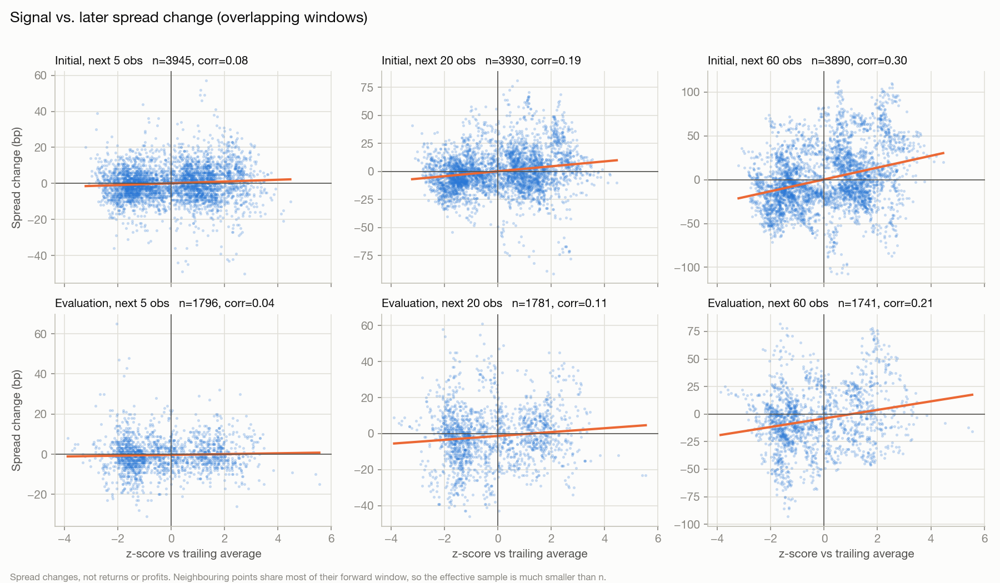

# US Treasury Yield Curve Analysis

A Python research project analyzing US Treasury par yield curves from 2000–2023. It combines data validation, yield-curve visualization, linear interpolation, and an exploratory study of mean reversion in the 10-year minus 2-year yield spread.

**Main finding:** The reported correlations do not support mean reversion toward the trailing 252-observation average at the horizons examined. The relationship is positive in both the initial and evaluation periods, although weaker in the evaluation period.

This project examines yield-spread changes. It does not calculate investment returns or establish a profitable trading strategy.

## Research question

When the 10-year minus 2-year Treasury yield spread is unusually high or low relative to its recent history, does it subsequently move back toward its recent average?

The analysis compares:

- The spread’s distance from its trailing average, expressed as a z-score.
- The spread’s subsequent change over 5, 20, and 60 observations.

A negative relationship would be consistent with mean reversion toward the historical reference average: unusually high spreads would tend to fall, and unusually low spreads would tend to rise.

## Methods

### Data preparation

The project combines three CSV files into a consistent dataset. The loading process standardizes column names and date formats, sorts observations, checks for duplicate dates, and reports missing values.

The original files remain unchanged. Missing yields are not filled.

### Yield-curve construction

The project plots published par yields across maturities and constructs a linear interpolation for one selected date.

The interpolated curve passes through the available input observations. Values between published maturities are estimates. The model does not extrapolate beyond the available maturity range.

This is an interpolated **par-yield curve**, not a bootstrapped discount curve, spot-rate curve, or forward-rate curve.

### Spread analysis

The spread is calculated as:

```text
Spread in basis points = (10-year yield in percent − 2-year yield in percent) × 100
```

The research signal measures the spread relative to its trailing 252-observation mean and standard deviation:

```text
Z-score = (current spread − trailing mean) / trailing standard deviation
```

Trailing statistics use observations preceding the signal date. Subsequent spread changes are measured over 5, 20, and 60 observations.

The sample is divided chronologically into an initial 70% and a later 30% evaluation period.

## Results

The generated charts report the following correlations between the trailing z-score and subsequent spread changes:

| Forward horizon | Initial period | Evaluation period |
|---|---:|---:|
| 5 observations | +0.08 | +0.04 |
| 20 observations | +0.19 | +0.11 |
| 60 observations | +0.30 | +0.21 |

All six correlations are positive. In this sample and specification, a higher spread relative to its recent average was associated with a higher subsequent spread change.

These results do not support the proposed negative relationship associated with mean reversion. The positive association is weaker in the evaluation period.

The scatter plots show substantial variation around the fitted lines. Statistical significance has not been established, and these results do not demonstrate trading profitability.



## Visualizations

| Chart | Description |
|---|---|
| `yield_curves.png` | Published par-yield curves for March 31, 2000; March 31, 2021; and July 3, 2023 |
| `spread_10y_2y_bp.png` | Historical 10-year minus 2-year spread, with negative spreads shaded |
| `interpolated_par_curve.png` | Published maturity points and a linearly interpolated par-yield curve |
| `spread_trailing_band.png` | Spread alongside its trailing 252-observation mean and a ±1 standard deviation band |
| `mean_reversion_scatter.png` | Signal versus subsequent spread changes across three horizons and two sample periods |

A negative 10-year minus 2-year spread means the 2-year yield exceeds the 10-year yield.


## Data

The input CSVs contain daily Treasury par-yield data spanning 2000–2023, with maturities ranging from 1 month to 30 years where available.

Source reference: [US Department of the Treasury — Daily Treasury Par Yield Curve Rates](https://home.treasury.gov/resource-center/data-chart-center/interest-rates/TextView?type=daily_treasury_yield_curve).

Original CSVs are stored in `data/raw/`. Their differing layouts are standardized by `src/load_data.py`.

Yields remain in their published percentage units: `4.25` represents 4.25%. Decimal conversions, where used, are explicitly labeled.

## Run the project

Requires Python 3.9 or newer.

```bash
git clone https://github.com/cjvolk/Yield-Curve-Project.git
cd Yield-Curve-Project

python3 -m venv .venv
source .venv/bin/activate

pip install -r requirements.txt
python main.py
```

On Windows PowerShell, activate the environment with:

```powershell
.venv\Scripts\Activate.ps1
```

The repository is currently private, so cloning requires authorized access.

Running `main.py` prints data checks and study results, generates charts in `outputs/figures/`, and writes processed tables to `data/processed/`.

Generated tables are excluded from version control and recreated when the project runs.

## Project structure

| Path | Purpose |
|---|---|
| `data/raw/` | Original input CSVs |
| `data/processed/` | Generated datasets and study tables |
| `outputs/figures/` | Saved charts |
| `src/load_data.py` | Data loading, standardization, validation, and unit conversions |
| `src/interpolate.py` | Linear par-yield interpolation and input-point checks |
| `src/mean_reversion.py` | Trailing signals, forward spread changes, and sample division |
| `src/plots.py` | Chart generation |
| `main.py` | Main entry point and chart-date configuration |
| `requirements.txt` | Python dependencies |

## Limitations

- **Overlapping outcomes:** Neighboring observations share future measurement periods. The plotted observations are not independent, and row counts overstate the amount of independent evidence. No dependence-adjusted significance tests are reported.
- **A moving reference average:** The study tests subsequent spread changes against a signal based on a trailing average. It does not directly measure whether the spread crosses its future moving average or establish long-run stationarity.
- **One specification:** Results apply to the selected trailing window, horizons, and sample division. They do not establish what happens under other specifications.
- **Limited evaluation:** The later sample provides one chronological evaluation period. It is not a guarantee of performance in other periods.
- **Changing maturity coverage:** Some maturities are unavailable during portions of the sample. Curves from different dates may contain different maturity points.
- **Observation-based horizons:** Horizons count dataset observations rather than calendar days. Missing values can further restrict eligible observations.
- **Historical coverage:** The dataset ends in December 2023 and does not describe current market conditions.
- **No return model:** The study does not include instrument prices, coupon income, financing, transaction costs, or position sizing.

## Next steps

- Audit signal timing and ensure forward measurement windows do not cross the initial/evaluation boundary.
- Assess uncertainty using methods that account for overlapping observations.
- Examine whether the relationship is stable across historical subperiods.
- Compare against simple forecasting baselines.
- Obtain appropriate instrument data before attempting a trading backtest.
